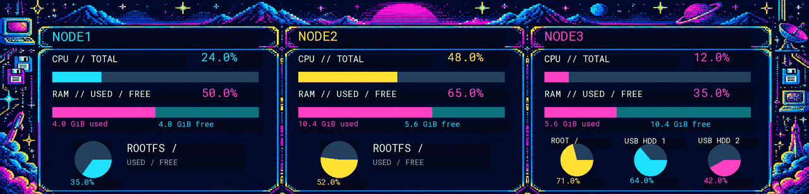

# MQTT Theme Extension for Turing Smart Screen

Live MQTT sensors for [turing-smart-screen-python](https://github.com/mathoudebine/turing-smart-screen-python), with graphical sensor selection in the theme editor and a Docker runtime. The upstream Python source stays unchanged.



*Rendered from the example theme with deterministic demo readings. Preview timing is shortened; the display switches views every 20 seconds.*

## Features

- Add MQTT sensors as text, numbers, bars, history graphs or pie charts in the editor.
- Preview live data and save widget settings directly to theme YAML, with backups.
- Edit themes on your desktop and run the display separately in Docker.
- Included TURZX 9.2-inch retro theme: three nodes with CPU, memory, RootFS/USB disks and parent-NIC RX/TX in MiB/s.
- Two rotating views, a shared background and optional batching of USB frame updates.

## Getting started

Use Python 3.14 and the upstream `main` branch:

```sh
git clone --branch main https://github.com/mathoudebine/turing-smart-screen-python.git turing-smart-screen-python
python -m pip install -r requirements-extension.txt -r turing-smart-screen-python/requirements.txt
cp -r examples/themes/MqttClusterRetro92 turing-smart-screen-python/res/themes/
```

Adapt the broker and sensor topics in `examples/cluster-mqtt.yaml` to your setup. Set these environment variables before starting Python:

| Variable | Value |
| --- | --- |
| `PYTHONPATH` | Absolute paths to this project's `bootstrap` directory and project root, separated by `:` on Linux/macOS or `;` on Windows |
| `TURZX_UPSTREAM` | Absolute path to the upstream checkout |
| `TURZX_MQTT_CONFIG` | Absolute path to your MQTT YAML configuration |
| `TURZX_MQTT_USER` / `TURZX_MQTT_PASSWORD` | Your broker credentials |

From the upstream directory, run `python theme-editor.py MqttClusterRetro92`. The MQTT selection window opens alongside the preview; **Ctrl+M** reopens it. For the display runtime, select the theme and panel in the upstream configuration and run `python main.py`.

See [the setup guide](README-MQTT.md) for detailed examples and [the theme](examples/themes/MqttClusterRetro92/theme.yaml) for the two-page configuration.

## Docker

The [Compose example](docker/compose.yaml) builds the runtime locally. Configure the MQTT topics/broker, set `TURZX_MQTT_USER`, `TURZX_MQTT_PASSWORD`, `TURZX_USB_DEVICE` and `TURZX_DOCKER_NETWORK`, then run:

```sh
docker compose -f docker/compose.yaml up -d --build
```

Set `TURZX_DOCKER_NETWORK` to an existing Docker network that can reach your broker. Replace `mqtt.example.com` in the MQTT configuration with your broker's hostname. USB access requires the panel to be attached to the Docker host. See [Docker configuration](docker/README.md).

## Container builds

[GitHub Actions](.github/workflows/docker.yml) runs the extension tests and builds Linux AMD64/ARM64 images. Pull requests build without publishing. Pushes to the default branch, version tags (`v*`) and manual runs on the default branch publish to `ghcr.io/<owner>/<repository>` using `GITHUB_TOKEN`.

The default branch publishes `latest`; version tags also publish their version, and every published build receives a commit tag. The workflow checks out upstream `main` automatically. After the first build, set the GHCR package visibility to public if anonymous pulls are wanted. No image is published until the workflow runs in your GitHub repository.

## Support

If this project is useful to you, consider buying me a coffee:

<a href="https://www.buymeacoffee.com/drivin"></a>

Built on [turing-smart-screen-python](https://github.com/mathoudebine/turing-smart-screen-python) and its TURZX USB driver. The retro background and its generation prompt are included with the example theme.
